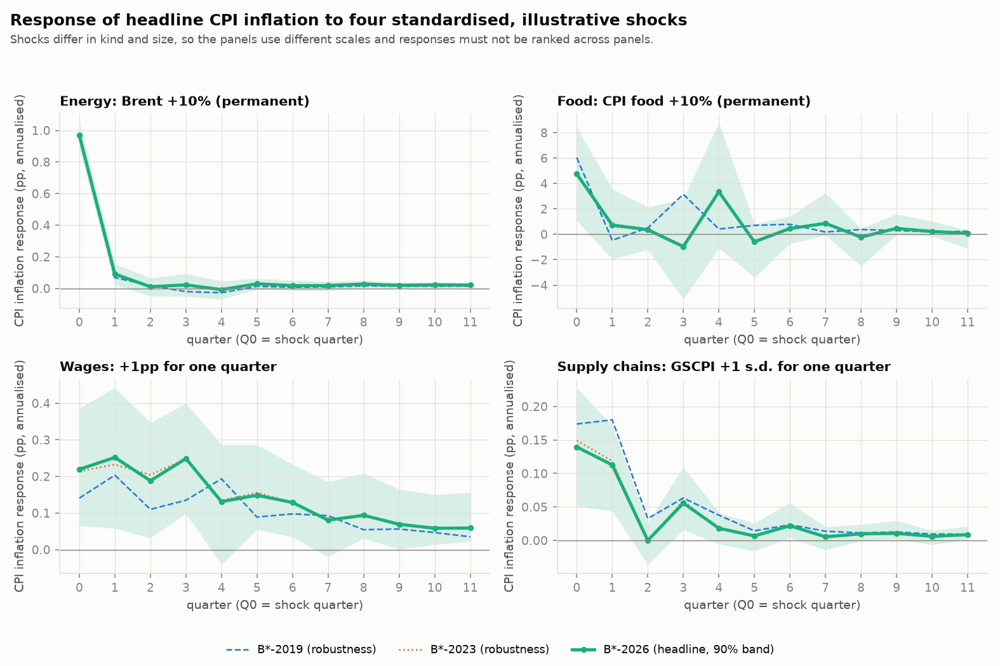

# Phase 4c (simplified): speed, magnitude and persistence of CPI inflation responses

Separate from `docs/phase4c_report.md`; nothing there or in `outputs/phase4c/` is changed. Code: `bb_inflation/phase4c/simple.py`, `scripts/run_p4c_simple.py`, `tests/test_phase4c_simple.py`. Outputs: `outputs/phase4c_simple/`.

## What is standardised

Same model as before (B\*, headline energy/food convention: nominal energy and food prices, relative prices endogenous; oil bridge elasticity 0.297, a calibrated assumption). Four shocks, hitting in Q0, followed for 12 quarters (Q0-Q11).
Units: annualised percentage points of CPI inflation; price level in % (sum of the annualised responses / 4). "After 3 years" is the cumulative effect over Q0-Q11, i.e. 12 quarters; the full report's price-level numbers span 13 quarters and are therefore slightly larger.

| shock         | what is shocked                           | size                             | duration                                                            | model input (units)                                                                                                           | implied change in the shocked CPI component                                                                    |
|:--------------|:------------------------------------------|:---------------------------------|:--------------------------------------------------------------------|:------------------------------------------------------------------------------------------------------------------------------|:---------------------------------------------------------------------------------------------------------------|
| Energy        | Brent crude price level (USD)             | +10% = +9.53 log points          | permanent: level stays 10% higher from the first month of Q0        | nominal CPI-energy growth, annualised pp, via the calibrated oil bridge (elasticity 0.297): +10.6 in Q0, +0.7 in Q1, ~0 after | CPI energy level +2.7% by end-Q0, +2.9% from Q1 on (not +10%)                                                  |
| Food          | CPI food price level (index, SA)          | +10% = +9.53 log points          | permanent: one jump in Q0, no further change                        | nominal CPI-food growth, annualised pp: +38.1 in Q0 (= 400 x ln 1.1), 0 afterwards                                            | CPI food level +10.0% from Q0 on                                                                               |
| Wages         | residual of the wage equation (ECI wages) | +1pp of annualised wage growth   | one quarter (Q0); wage growth afterwards is determined by the model | additive shock to the wage equation in Q0, annualised pp                                                                      | ECI wage level +0.25% in Q0; wage growth responds +0.18pp in Q1 and fades; wage level +0.63% after 12 quarters |
| Supply chains | NY Fed GSCPI (standard-deviation units)   | +1 s.d. = +0.969 (1998Q1-2026Q2) | one quarter (Q0)                                                    | GSCPI +0.969 in Q0; the price equation uses the 2-quarter mean, so +0.485 in Q0 and Q1                                        | none: an index of pressure, not a price                                                                        |

**These shocks are illustrative, not economically equivalent**: a 10% Brent move raises CPI energy by only about 2.9%, a 10% food-price move raises CPI food by 10%, the wage shock is one quarter of +1pp, and the GSCPI shock is a standard deviation of an index. A larger response says nothing about which driver matters more in practice; that depends on how large and how persistent such shocks actually are.

## Headline: B\*-2026 (90% parameter bands)

| Shock                                                           | Q0 response (pp)   | Peak response (pp)   | Quarter of peak   | Persistence: quarters from peak until response first falls below 50% of peak   | Rebound above half-peak afterwards?                   | CPI price-level effect after 3 years (%)   |
|:----------------------------------------------------------------|:-------------------|:---------------------|:------------------|:-------------------------------------------------------------------------------|:------------------------------------------------------|:-------------------------------------------|
| Energy: Brent +10% (permanent)                                  | 0.97 [0.89, 1.05]  | 0.97 [0.89, 1.05]    | 0 [0, 0]          | 1Q [1, 1]                                                                      | no at point estimate; 0% of draws rebound             | 0.31 [0.22, 0.39]                          |
| Food: CPI food +10% (permanent)                                 | 4.77 [1.08, 8.46]  | 4.77 [2.81, 9.62]    | 0 [0, 4]          | 1Q [1, 2]                                                                      | YES: back above half-peak in Q4; 33% of draws rebound | 2.38 [1.13, 3.56]                          |
| Food, SENSITIVITY: same +10% shock, food lags 0-3 only (not B*) | 4.64 [1.11, 8.30]  | 4.64 [2.33, 8.30]    | 0 [0, 3]          | 1Q [1, 2]                                                                      | no at point estimate; 30% of draws rebound            | 2.07 [0.82, 3.46]                          |
| Wages: +1pp for one quarter                                     | 0.22 [0.07, 0.39]  | 0.25 [0.23, 0.47]    | 1 [0, 4]          | 6Q [1, 6]                                                                      | no at point estimate; 67% of draws rebound            | 0.42 [0.28, 0.63]                          |
| Supply chains: GSCPI +1 s.d. for one quarter                    | 0.14 [0.05, 0.23]  | 0.14 [0.05, 0.23]    | 0 [0, 0]          | 2Q [2, 2]                                                                      | no at point estimate; 17% of draws rebound            | 0.10 [0.04, 0.16]                          |

*Food sensitivity row.* The row "Food, SENSITIVITY" is not B\*: it repeats the food shock with a price equation whose food block has lags 0 to 3 instead of 0 to 4 (only the price equation is re-fitted, same sample and restrictions; the other equations are B\*-2026). It is there because the Q4 rebound in the B\* food row comes from the lag-4 coefficient (Clarification 2). Its band comes from that fit's own HAC covariance, so it is comparable in kind, not in construction, with the B\* rows. With lag 4 removed: peak 4.64pp (B\*: 4.77pp), persistence 1Q, no at point estimate, price level after 3 years 2.07% (B\*: 2.38%). Removing lag 4 removes the point-estimate echo but not the rebounds across draws (30% of draws against 33% in B\*): uncertainty in the remaining lag coefficients still produces a rebound in about a third of draws, so the path shape beyond Q0 stays uncertain either way. The headline food row remains the B\* one.

*Persistence column.* Number of quarters from the peak until the CPI inflation response first falls below 50% of its peak (peak in Q1 and first below half in Q5 = 4 quarters). "Not reached within 12Q" means the response is still at or above half its peak at the end of the 12-quarter horizon, so it has not dissipated as far as this horizon shows. The next column **flags responses that fall below half the peak and later come back to at least half of it** within the horizon: for those the persistence figure alone overstates how quickly the effect fades. Percentages are the share of the 2000 coefficient draws in which the flag applies; persistence bands use the draws that do fall below half the peak (draws that never do are counted in "not reached in x% of draws").

## Reading the three questions

1. **Speed.** Energy, food and supply-chain shocks act almost immediately: the Q0 response is already 0.97pp (energy), 4.77pp (food) and 0.14pp (supply chains), because their prices enter the CPI equation in the same quarter. The wage shock builds more slowly:
   0.22pp in Q0 and 0.25pp in Q1.
2. **Magnitude.** Peaks are 0.97pp (energy), 4.77pp (food), 0.25pp (wages) and 0.14pp (supply chains), for the shock sizes above only. Peaks are in annualised terms for one quarter; the price-level column shows what accumulates.
3. **Persistence and price level.** Energy: 1Q after the peak (no rebound), price level 0.31%. Supply chains: 2Q after the peak, price level 0.10%, but the flag applies in 17% of draws. Wages: 6Q from the peak at the point estimate, with a price-level effect of 0.42%; the wage response is jagged, falls below half its peak and returns to it in 67% of draws, so the point estimate understates how long it can last, and the timing of its peak is flat between Q1 and Q3.
   Food: persistence 1Q but **flagged** (back above half-peak in Q4; 33% of draws), with a cumulative effect of 2.38% for a 10% rise in CPI food, about 24% of the food shock's size and more than food's CPI weight (roughly 14%), which the authors also found (second-round effects).
   No response is "not reached" at the point estimate: all four fall below half their peak within the horizon.

**One caution on food.** The headline persistence of 1 quarter is misleading: the food response has an echo four quarters later (Q4: 3.4pp, 70% of the Q0 peak in B\*-2026; 73% in B\*-2023 and 7% in B\*-2019), which is why it is flagged. It comes from the lag-4 food coefficient, 0.078 in B\*-2026 and 0.014 in B\*-2019, next to a negative lag-3 coefficient (-0.061): a four-quarter alternating pattern that the pandemic years introduced; it is most likely a specification artefact (Clarification 2 below).
Read the food path beyond Q0 as less reliable than its cumulative effect.

## Robustness: B\*-2019 and B\*-2023

| Shock         | Sample   |   Q0 response (pp) | Peak response (pp)   |   Quarter of peak | Persistence: quarters from peak until response first falls below 50% of peak   | Rebound above half-peak afterwards?                   | CPI price-level effect after 3 years (%)   |
|:--------------|:---------|-------------------:|:---------------------|------------------:|:-------------------------------------------------------------------------------|:------------------------------------------------------|:-------------------------------------------|
| Energy        | B*-2026  |               0.97 | 0.97 [0.89, 1.05]    |                 0 | 1Q                                                                             | no at point estimate; 0% of draws rebound             | 0.31 [0.22, 0.39]                          |
| Energy        | B*-2019  |               0.96 | 0.96 [0.87, 1.05]    |                 0 | 1Q                                                                             | no at point estimate; 0% of draws rebound             | 0.27 [0.19, 0.35]                          |
| Energy        | B*-2023  |               0.97 | 0.97 [0.89, 1.06]    |                 0 | 1Q                                                                             | no at point estimate; 0% of draws rebound             | 0.31 [0.23, 0.39]                          |
| Food          | B*-2026  |               4.77 | 4.77 [2.81, 9.62]    |                 0 | 1Q                                                                             | YES: back above half-peak in Q4; 33% of draws rebound | 2.38 [1.13, 3.56]                          |
| Food          | B*-2019  |               6.04 | 6.04 [4.09, 8.21]    |                 0 | 1Q                                                                             | YES: back above half-peak in Q3; 52% of draws rebound | 3.11 [1.62, 4.62]                          |
| Food          | B*-2023  |               4.65 | 4.65 [2.75, 9.71]    |                 0 | 1Q                                                                             | YES: back above half-peak in Q4; 34% of draws rebound | 2.34 [1.06, 3.53]                          |
| Wages         | B*-2026  |               0.22 | 0.25 [0.23, 0.47]    |                 1 | 6Q                                                                             | no at point estimate; 67% of draws rebound            | 0.42 [0.28, 0.63]                          |
| Wages         | B*-2019  |               0.14 | 0.20 [0.16, 0.37]    |                 1 | 4Q                                                                             | no at point estimate; 63% of draws rebound            | 0.31 [0.19, 0.54]                          |
| Wages         | B*-2023  |               0.21 | 0.25 [0.23, 0.47]    |                 3 | 4Q                                                                             | no at point estimate; 67% of draws rebound            | 0.42 [0.28, 0.63]                          |
| Supply chains | B*-2026  |               0.14 | 0.14 [0.05, 0.23]    |                 0 | 2Q                                                                             | no at point estimate; 17% of draws rebound            | 0.10 [0.04, 0.16]                          |
| Supply chains | B*-2019  |               0.17 | 0.18 [0.05, 0.33]    |                 1 | 1Q                                                                             | no at point estimate; 4% of draws rebound             | 0.15 [0.04, 0.27]                          |
| Supply chains | B*-2023  |               0.15 | 0.15 [0.06, 0.24]    |                 0 | 2Q                                                                             | no at point estimate; 18% of draws rebound            | 0.10 [0.04, 0.16]                          |

Differences from B\*-2026 (joint coefficient draws, so the overlap of the samples is respected; 90% band and two-sided p):

| Shock         | Statistic                            | B*-2026 minus B*-2019          | B*-2026 minus B*-2023          |
|:--------------|:-------------------------------------|:-------------------------------|:-------------------------------|
| Energy        | Peak response (pp)                   | +0.01 [-0.03, +0.06], p = 0.68 | -0.00 [-0.01, +0.01], p = 0.60 |
| Energy        | Price-level effect after 3 years (%) | +0.04 [-0.03, +0.11], p = 0.35 | -0.00 [-0.01, +0.01], p = 0.77 |
| Food          | Peak response (pp)                   | -1.28 [-3.29, +3.56], p = 0.87 | +0.11 [-0.33, +0.37], p = 0.98 |
| Food          | Price-level effect after 3 years (%) | -0.73 [-1.82, +0.26], p = 0.22 | +0.04 [-0.19, +0.28], p = 0.72 |
| Wages         | Peak response (pp)                   | +0.05 [-0.02, +0.19], p = 0.20 | +0.00 [-0.03, +0.03], p = 0.96 |
| Wages         | Price-level effect after 3 years (%) | +0.11 [-0.01, +0.20], p = 0.11 | +0.00 [-0.02, +0.02], p = 0.99 |
| Supply chains | Peak response (pp)                   | -0.04 [-0.20, +0.11], p = 0.62 | -0.01 [-0.03, +0.01], p = 0.45 |
| Supply chains | Price-level effect after 3 years (%) | -0.05 [-0.18, +0.06], p = 0.47 | -0.00 [-0.02, +0.01], p = 0.63 |

The qualitative answers are the same in all three samples. The differences that stand out run in the same direction as the full report: a larger wage price-level effect in the later samples (+0.11pp, p = 0.11), and smaller food (-0.73pp, p = 0.22) and supply-chain effects; none is significant at 10%. The B\*-2019 supply-chain result rests on low-amplitude pre-pandemic GSCPI variation (§3.3 of the full report). Between B\*-2023 and B\*-2026 nothing changes.

## Clarifications requested at review

**1. Definition, magnitude, duration and units of the shocks.** The table at the top of this note gives, for each shock, what is shocked, its size, how long it lasts, the units of the model input and the change it implies in the CPI component concerned. Two points on units. (i) Responses are annualised percentage-point rates for one quarter: food's Q0 response of 4.77pp is about 1.2% on the price level in Q0, not 4.8% on the price level. (ii) **Food**: the CPI food price *level* is raised by 10% (9.53 log points) in Q0 and stays there; because the model takes nominal CPI food *growth* as an annualised rate, this enters as one jump of 400 x ln(1.1) = +38.1pp in Q0 and zero afterwards. Wages are not shocked, so the relative food price (food over wages) then drifts down again as wages grow.
**Energy** is a different kind of variable: the shock is to Brent, and the calibrated bridge turns it into a CPI-energy rise of only about 2.9% in total (2.7% by the end of Q0).

**2. Why does the food response rebound in Q4: transmission mechanism or specification artefact?** *Most likely an artefact of the unrestricted five-lag food block, identified by one observation; not a credible transmission channel.*

- *Mechanics.* The price equation has food-price growth at lags 0 to 4, so a one-off jump in Q0 reappears four quarters later through the lag-4 coefficient: 2.98pp of the 3.35pp Q4 response is that coefficient times 38.1 (the rest is feedback). The lag-3 coefficient is negative and offsets part of it one quarter earlier (Q3 = -0.97pp).
- *Estimates (HAC s.e. in brackets):*

| sample   | L0             | L1             | L2             | L3             | L4             |   sum |
|:---------|:---------------|:---------------|:---------------|:---------------|:---------------|------:|
| B*-2019  | +0.159 (0.035) | -0.018 (0.034) | -0.010 (0.031) | +0.052 (0.033) | +0.014 (0.040) | 0.196 |
| B*-2023  | +0.122 (0.060) | +0.040 (0.040) | -0.004 (0.040) | -0.057 (0.069) | +0.081 (0.067) | 0.182 |
| B*-2026  | +0.125 (0.059) | +0.043 (0.040) | -0.006 (0.038) | -0.061 (0.068) | +0.078 (0.067) | 0.179 |

- *Weak statistical support.* L4 alone: p = 0.25; L3 and L4 jointly: p = 0.51. The 90% band for the Q4 response, [-1.1, 8.8]pp, includes zero.
- *Not there before the pandemic.* L4 is 0.014 in B\*-2019 (the recursive estimate is 0.008 as late as 2020Q3 and 0.107 by 2021Q2).
- *One observation.* Dropping only the 2021Q2 observation moves L4 from +0.078 to -0.013 and removes the echo (table below). That quarter's CPI inflation (8.5% annualised, in the 2021 reopening surge) came exactly four quarters after the 2020Q2 food-price spike (relative food growth +9.0pp), so the regression can read a coincidence of timing as a four-quarter lag. A lag of four quarters could be rationalised by annual repricing or contracts, but the alternating signs (L3 negative, L4 positive, net +0.017) and the absence of any pre-2020 evidence do not support that reading.

| price equation                         | food L3   | food L4   |   sum of food lags |   response Q3 (pp) |   response Q4 (pp) |   Q4 as % of Q0 | rebound above half-peak?   |   price level after 12 quarters (%) |
|:---------------------------------------|:----------|:----------|-------------------:|-------------------:|-------------------:|----------------:|:---------------------------|------------------------------------:|
| B*-2026 as estimated (food lags 0-4)   | -0.061    | +0.078    |               0.18 |              -0.97 |               3.35 |           70.27 | yes                        |                                2.38 |
| food lags 0-3                          | -0.049    | -         |               0.14 |              -0.62 |               0.83 |           17.96 | no                         |                                2.07 |
| food lags 0-2                          | -         | -         |               0.16 |               1    |               0.16 |            3.53 | no                         |                                2.24 |
| B*-2026 without the 2021Q2 observation | -0.025    | -0.013    |               0.13 |               0.01 |               0.1  |            2.24 | no                         |                                2.11 |
| B*-2026 without 2021Q1-Q2              | +0.035    | -0.012    |               0.15 |               1.93 |              -0.33 |           -8.05 | no                         |                                2.27 |
| B*-2026 without 2022Q1-Q4              | -0.062    | +0.080    |               0.18 |              -0.55 |               3.11 |           68.42 | yes                        |                                2.58 |

- *What is robust.* The cumulative effect: 2.07% to 2.58% across all variants (2.38% as estimated). The Q0 response and the sum of food coefficients (0.13 to 0.18) are also stable; the path from Q1 to Q4 is not.

The rebound flag therefore stays in the table (it describes the model as estimated), but read food's persistence from the cumulative effect. A food block with lags 0 to 3 or 0 to 2 gives no rebound and a cumulative effect of 2.07% or 2.24%; I have **not** adopted either as the headline, because that would depart from the authors' lag structure and from B\*; the lags 0-3 version is shown as a clearly labelled sensitivity row in the headline table.

**3. Why does the wage shock rebound in 67% of coefficient draws when the point estimate does not?** *Because the point-estimate path is double-humped and sits within a few percentage points of the 50% threshold for three quarters, so almost any change in the imprecisely estimated lag coefficients moves the crossing, and the first crossing is usually followed by another hump.*

| quarter   |   point estimate (pp) | as % of peak   | 90% band      | draws below half the peak   |
|:----------|----------------------:|:---------------|:--------------|:----------------------------|
| Q0        |                 0.219 | 87%            | [0.07, 0.39]  | 17%                         |
| Q1        |                 0.252 | 100%           | [0.06, 0.44]  | 15%                         |
| Q2        |                 0.188 | 75%            | [0.03, 0.35]  | 25%                         |
| Q3        |                 0.249 | 99%            | [0.10, 0.40]  | 10%                         |
| Q4        |                 0.131 | 52%            | [-0.04, 0.29] | 48%                         |
| Q5        |                 0.149 | 59%            | [0.06, 0.29]  | 32%                         |
| Q6        |                 0.129 | 51%            | [0.03, 0.23]  | 49%                         |
| Q7        |                 0.081 | 32%            | [-0.02, 0.19] | 77%                         |
| Q8        |                 0.094 | 37%            | [0.03, 0.21]  | 69%                         |
| Q9        |                 0.069 | 28%            | [0.00, 0.16]  | 86%                         |
| Q10       |                 0.058 | 23%            | [0.01, 0.15]  | 91%                         |
| Q11       |                 0.059 | 23%            | [0.02, 0.16]  | 89%                         |

- At the point estimate the response peaks in Q1, dips in Q2 (75% of peak), is back at 99% in Q3, then runs at 52%, 59% and 51% of the peak in Q4 to Q6 (threshold 50%) before falling to 32% in Q7. The "6 quarters" is where the path happens to cross; a small change makes it cross in Q4 or Q6 or never.
- Across draws the median persistence is 1 quarter, not 6: in 78% of draws the response is below half its peak within three quarters of the peak. The first hump (Q1) is followed by a trough (Q2) and a second hump (Q3); in the draws that rebound, the average rebound quarter is Q4.
- The humps come from the lag structure. The price equation's own-lag coefficients are L1 = -0.197 (0.106) and L3 = +0.254 (0.109) in B\*-2026, against +0.033 (0.085) and +0.187 (0.066) in B\*-2019; the wage and expectations equations also have uneven, individually imprecise lag patterns. The sums of lag coefficients are well determined; their timing within the year is not.
- The flag is sensitive to quarter-to-quarter noise. Share of draws flagged as rebounding, on the quarterly response (as in the table) and on 2- and 4-quarter averages of it:

| shock         | quarterly response (as flagged)   | 2-quarter average   | 4-quarter average (y/y)   |
|:--------------|:----------------------------------|:--------------------|:--------------------------|
| Energy        | 0%                                | 0%                  | 0%                        |
| Food          | 33%                               | 26%                 | 17%                       |
| Wages         | 67%                               | 30%                 | 12%                       |
| Supply chains | 17%                               | 0%                  | 1%                        |

For wages the share falls from 67% to 30% and 12% when the response is averaged over two or four quarters, which supports reading it as jaggedness of an imprecisely estimated lag pattern, not a genuine second wave. Better read: the wage impulse takes roughly one to six quarters to fall to half its peak (point estimate 6, median draw 1, shape uncertain), with a more reliable cumulative effect of 0.42 [0.28, 0.63]%.

**4. Are the food and energy scenarios comparable price-level shifts?** *No: the standardised shocks move their own CPI components by very different amounts, and that accounts for most of the gap in cumulative effects.*

| shock                                            |   change in own CPI component (%) |   basket share (%, authors' quote) |   direct arithmetic: share x change (%) |   model: price level after 12 quarters (%) | 90% band     |   model / direct |   model effect per 1% rise in own component |
|:-------------------------------------------------|----------------------------------:|-----------------------------------:|----------------------------------------:|-------------------------------------------:|:-------------|-----------------:|--------------------------------------------:|
| Energy, as standardised: Brent +10%              |                              2.87 |                                7.4 |                                    0.21 |                                       0.31 | [0.22, 0.39] |             1.46 |                                        0.11 |
| Food, as standardised: CPI food +10%             |                             10    |                               14.4 |                                    1.44 |                                       2.38 | [1.13, 3.56] |             1.65 |                                        0.24 |
| Energy, like-for-like with food: CPI energy +10% |                             10    |                                7.4 |                                    0.74 |                                       1.05 | [0.75, 1.32] |             1.41 |                                        0.1  |
| Food, like-for-like with energy: CPI food +2.9%  |                              2.87 |                               14.4 |                                    0.41 |                                       0.71 | [0.33, 1.06] |             1.71 |                                        0.25 |

Basket shares are the ones quoted by Bernanke and Blanchard (about 7.4% energy, 14.4% food), not recomputed here; "direct arithmetic" is share x change, i.e. the price-level effect with no second-round effects.

- Brent +10% moves CPI energy by only 2.9%, whereas food is moved by 10%. Of the 7.7-fold difference in cumulative effects, a factor of 3.5 is shock size and a factor of 2.2 is structure (effect per 1% rise in the component: 0.24 for food, 0.11 for energy).
- On a like-for-like basis (each component +10%, or each +2.9%) food's effect is about 2.3 times energy's. That is close to the ratio of basket shares (1.9), plus a somewhat larger second-round multiplier for food (1.65 times direct, against 1.41 for energy).
- So the standardised food shock is not a "bigger" shock in any economic sense; it is a larger price move in a larger part of the basket. The like-for-like rows are diagnostics for this note and are not added to the headline table.

## What this simplification drops

The expectations paths and wage responses to these shocks, the V/U and expectations shocks, the temporary oil episodes, the authors' relative-price convention (wage responses are larger under it), the authors' own model, persistence beyond 12 quarters and the formal tests of coefficient stability. All remain in the full report (`docs/phase4c_report.md`) and workbook.
